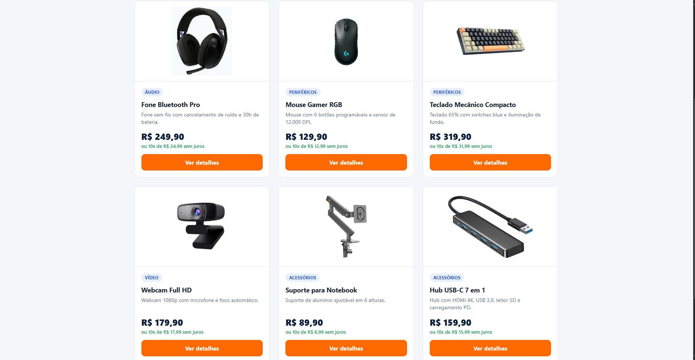
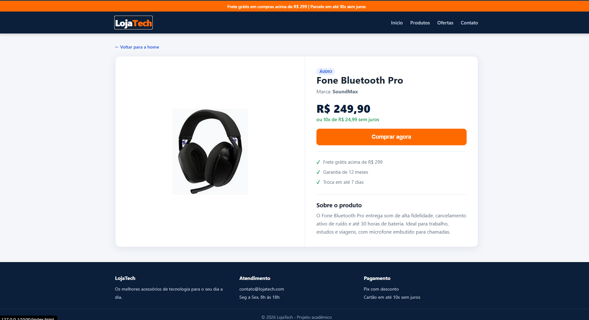

Aluno: Vinicius Arantes Silva  
Matrícula: 936807  

Prints

Home-page


Página de detalhes


Dados JSON (app.js)

```js
const dados = [
  {
    "id": 1,
    "titulo": "Fone Bluetooth Pro",
    "descricao": "Fone sem fio com cancelamento de ruído e 30h de bateria.",
    "conteudo": "O Fone Bluetooth Pro entrega som de alta fidelidade, cancelamento ativo de ruído e até 30 horas de bateria. Ideal para trabalho, estudos e viagens, com microfone embutido para chamadas.",
    "categoria": "Áudio",
    "marca": "SoundMax",
    "preco": 249.90,
    "imagem": "img/fone.jpg"
  },
  {
    "id": 2,
    "titulo": "Mouse Gamer RGB",
    "descricao": "Mouse com 6 botões programáveis e sensor de 12.000 DPI.",
    "conteudo": "Com sensor óptico de 12.000 DPI, iluminação RGB personalizável e 6 botões programáveis, o Mouse Gamer RGB oferece precisão e conforto para longas sessões de jogo ou trabalho.",
    "categoria": "Periféricos",
    "marca": "ProGear",
    "preco": 129.90,
    "imagem": "img/mouse.jpg"
  },
  {
    "id": 3,
    "titulo": "Teclado Mecânico Compacto",
    "descricao": "Teclado 65% com switches blue e iluminação de fundo.",
    "conteudo": "Teclado mecânico compacto (65%) com switches blue, resposta tátil e sonora, iluminação de fundo e estrutura em metal. Perfeito para quem programa ou joga.",
    "categoria": "Periféricos",
    "marca": "KeyForge",
    "preco": 319.90,
    "imagem": "img/teclado.jpg"
  },
  {
    "id": 4,
    "titulo": "Webcam Full HD",
    "descricao": "Webcam 1080p com microfone e foco automático.",
    "conteudo": "Webcam com resolução Full HD 1080p, foco automático, correção de luz e microfone com redução de ruído. Compatível com Zoom, Meet e Teams.",
    "categoria": "Vídeo",
    "marca": "ClearView",
    "preco": 179.90,
    "imagem": "img/webcam.jpg"
  },
  {
    "id": 5,
    "titulo": "Suporte para Notebook",
    "descricao": "Suporte de alumínio ajustável em 6 alturas.",
    "conteudo": "Suporte de alumínio dobrável, com 6 níveis de altura, que melhora a postura e a ventilação do notebook. Leve e fácil de transportar.",
    "categoria": "Acessórios",
    "marca": "ErgoDesk",
    "preco": 89.90,
    "imagem": "img/suporte.jpg"
  },
  {
    "id": 6,
    "titulo": "Hub USB-C 7 em 1",
    "descricao": "Hub com HDMI 4K, USB 3.0, leitor SD e carregamento PD.",
    "conteudo": "Hub USB-C 7 em 1 com saída HDMI 4K, 3 portas USB 3.0, leitor de cartão SD/microSD e entrada de carregamento Power Delivery de até 100W.",
    "categoria": "Acessórios",
    "marca": "ConnectPlus",
    "preco": 159.90,
    "imagem": "img/hub.jpg"
  }
];
```